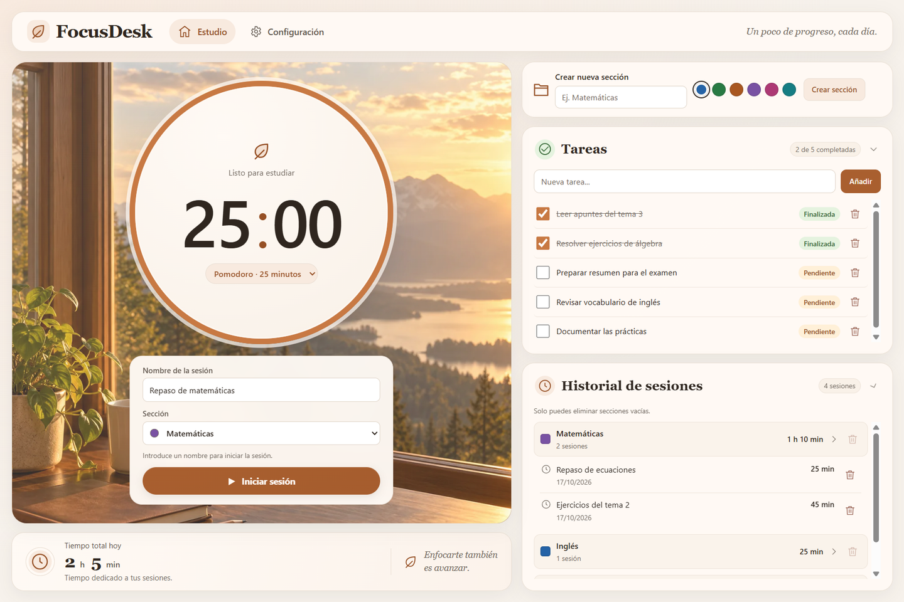
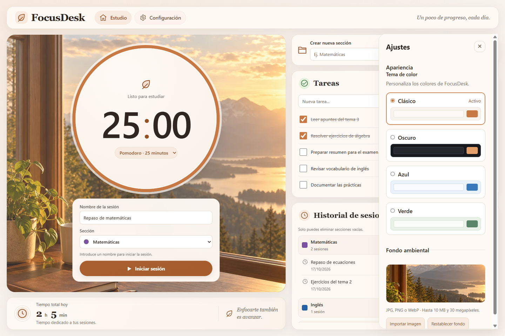

# FocusDesk

Aplicación de escritorio para organizar el estudio en bloques de concentración, gestionar tareas y consultar el tiempo dedicado a cada sección. Funciona localmente, sin cuenta, servidor ni conexión a Internet.

Proyecto de portfolio centrado en una interfaz clara, separación entre React y Electron y persistencia local. **Versión candidata: 1.0.0; pendiente de aprobación para su primera publicación.**



## Funcionalidades

- **Pomodoro de 25, 45 o 50 minutos.** Nombre y sección obligatorios; controles bloqueados durante la sesión. Finalización automática o anticipada con registro del tiempo estudiado y protección frente a duplicados.
- **Secciones personalizadas** con nombre y uno de seis colores. Solo se pueden eliminar si están vacías y sin una sesión activa.
- **Tareas:** creación, marcado como completadas o pendientes y eliminación, en un panel desplegable con scroll independiente.
- **Historial por secciones:** grupos desplegables, nombre, fecha y duración legible; eliminación individual con confirmación y total diario actualizado. Las sesiones antiguas sin sección siguen en «Sin sección».
- **Editorial Premium:** cuatro temas (Clásico, Oscuro, Azul y Verde), diseño adaptable y ajustes junto a Estudio. No existe selector de diseños.
- **Fondos personalizados:** JPG, PNG o WebP de hasta 10 MB y 30 megapíxeles. Importación, vista previa y restablecimiento del fondo original.
- **Persistencia local:** tareas, sesiones, secciones, tema e imágenes importadas se conservan al reiniciar.

## Tecnologías y estructura

Electron, React 18, TypeScript, Vite, electron-store, CSS y electron-builder con NSIS. No hay servicios externos ni base de datos remota.

```text
electron/          Ventana, IPC, almacenamiento e importación de imágenes
src/components/    Temporizador, formularios, tareas, historial y ajustes
src/hooks/         Estado de la aplicación, Pomodoro y fondo
src/layouts/       Composición de Editorial Premium
src/utils/         Formato de tiempo, temas y colores
build/             Icono vectorial y archivo ICO multirresolución
public/            Icono PNG de la ventana
```

`useFocusDesk` mantiene el estado compartido; `useTimer` calcula el tiempo a partir del instante de inicio y actualiza el reloj al recuperar foco. El preload expone operaciones concretas, sin acceso genérico a IPC o archivos. El renderer tiene `contextIsolation` y sandbox activados, con Node.js deshabilitado. La compilación de producción incluye una política de seguridad de contenido y recursos locales.

## Desarrollo

Requisitos: **Node.js 22.12 o superior**, npm y Git. Para generar el instalador indicado se utiliza Windows de 64 bits.

```bash
git clone https://github.com/dcarpin03/focusdesk.git
cd focusdesk
npm ci
npm run dev
```

`npm run dev` inicia Vite y abre Electron. `npm run preview` permite inspeccionar el frontend compilado, pero no sustituye a Electron: el almacenamiento y los ajustes necesitan el preload.

```bash
npm run typecheck
npm run lint
npm run build:app
npm run build
```

- `typecheck`: TypeScript sin emitir archivos.
- `lint`: ESLint, sin advertencias permitidas.
- `build:app`: compila el frontend y los procesos principal/preload, sin instalador.
- `build`: realiza lo anterior y genera NSIS x64, sin publicar artefactos.

El instalador se escribe en:

```text
release/1.0.0/FocusDesk-1.0.0-Windows-x64-Setup.exe
```

La carpeta `release/1.0.0/win-unpacked/` permite comprobar la aplicación empaquetada antes de instalarla. Ambas salidas están excluidas de Git. La aplicación distribuida incorpora su runtime y abre el frontend compilado; no requiere Node.js, npm ni Vite en el equipo de destino.

## Instalación en Windows

La distribución objetivo es Windows 10/11 x64. Descarga el instalador únicamente cuando se publique una versión aprobada en [GitHub Releases](https://github.com/dcarpin03/focusdesk/releases); todavía no se enlaza ninguna versión definitiva.

1. Ejecuta `FocusDesk-1.0.0-Windows-x64-Setup.exe` y sigue el asistente por usuario.
2. Elige la carpeta y si quieres crear el acceso directo al escritorio.
3. Abre FocusDesk desde el menú Inicio o el acceso directo.
4. Para desinstalar, utiliza Aplicaciones instaladas de Windows. Los datos personales se conservan.

**El instalador no está firmado digitalmente.** Windows SmartScreen puede mostrar un aviso de editor desconocido. No es necesario desactivar SmartScreen, Defender ni otras protecciones; si Windows bloquea el archivo, comprueba su procedencia y el checksum publicado antes de decidir si ejecutarlo.

## Datos y comportamiento del temporizador

Electron guarda `config.json` y la carpeta `backgrounds` dentro de su directorio de usuario, normalmente `%APPDATA%\focusdesk` en Windows, fuera de la instalación. Para hacer una copia de seguridad, cierra la aplicación y copia esa carpeta completa. No borres los datos para actualizar o reinstalar.

Las sesiones conservan su formato original (`id`, `name`, `durationSeconds`, `date` y `sectionId` opcional). Las secciones antiguas sin color reciben el azul predeterminado sin cambiar sus identificadores. Las preferencias antiguas de diseño se ignoran sin eliminarse.

- La finalización manual guarda segundos completos; menos de un segundo no crea un registro vacío.
- La finalización automática registra como máximo la duración elegida, incluso si un intervalo se retrasa.
- La sesión se asigna a la **fecha local de finalización**. Si cruza medianoche, no se reparte entre dos días. El total de hoy se actualiza al cambiar la fecha o recuperar foco.
- **Cerrar Electron durante una sesión la descarta.** No se recupera ni se guarda parcialmente al reabrir.
- Si falla un guardado, se muestra un aviso y se puede reintentar conservando los cambios en memoria. No cierres la aplicación hasta resolverlo. Si falla la carga inicial, se impiden escrituras para evitar sobrescribir datos existentes.

Las imágenes se validan y copian con nombre UUID a `backgrounds`; solo ese nombre relativo se guarda en electron-store. Mover o borrar el original no afecta a la copia. Un fondo ausente o corrupto vuelve al predeterminado con aviso en Ajustes, sin borrar datos de estudio. El [origen del fondo predeterminado](src/assets/editorial/README.md) se documenta por separado.

## Capturas y validación de la versión candidata

Las capturas de `docs/screenshots/` proceden de la aplicación ejecutándose con datos de prueba; no son mockups. El fondo decorativo predeterminado tiene la procedencia indicada arriba.



Consulta el [informe de validación y pruebas de instalación](docs/VALIDATION.md) y la [propuesta de release 1.0.0](docs/RELEASE-1.0.0.md). Los Pomodoros largos se comprueban con reloj simulado; esto no equivale a una prueba real de 50 minutos ni a probar suspensión del sistema.

## Autor

Desarrollado por [dcarpin03](https://github.com/dcarpin03) como proyecto personal de portfolio. Permite demostrar trabajo con componentes y hooks de React, TypeScript, procesos de Electron, IPC, persistencia, recursos locales y distribución en Windows.
